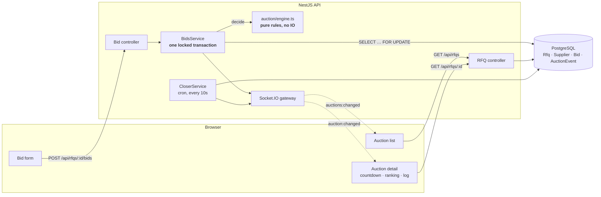

# High-level design

## The problem in one line

A reverse auction where the finish line moves, and must never move past a
hard ceiling.

Everything else in this system is ordinary CRUD. The whole design exists to
make that one sentence true under concurrency, and to make every movement of
the finish line explainable afterwards.

## Components



## The three pieces that matter

### 1. `auction/engine.ts` — the rules, with nothing else in them

Ranking, the trigger window, the three trigger types and the forced-close clamp
are pure functions. They take a clock, a config and two rankings, and return a
decision plus the sentence explaining it.

No database, no `Date.now()`, no framework. That buys three things:

- the rules can be tested exhaustively in milliseconds, including a
  brute-force proof that no sequence of bids pushes the close past the ceiling
- a reviewer can read the entire auction specification in one file without
  knowing NestJS
- the decision and its reason are produced together, so the activity log
  records why something happened rather than inferring it later

### 2. `BidsService.submit` — one locked transaction

Submitting a bid is a read-modify-write on shared state:

```
lock the RFQ row  →  read live quotes  →  insert bid
                  →  recompute ranking →  decide extension
                  →  move the close    →  write the log
```

All of it inside one transaction that opens with
`SELECT id FROM "Rfq" WHERE id = $1 FOR UPDATE`.

**Why the lock.** The moment this matters most is the final seconds, which is
exactly when two suppliers are most likely to bid at once. Without it both
transactions read the same "before" ranking, both conclude the auction should
extend, and the close either jumps 2Y into the future or loses an extension
entirely, depending on which write lands last. Nothing raises. The auction
just ends at the wrong time.

**Why a row lock rather than `SERIALIZABLE`.** Serializable would also be
correct, but conflicting transactions fail and have to be retried. An explicit
row lock makes the second bid *wait* a few milliseconds instead — which is the
behaviour a supplier expects at 17:59:59, rather than a rejection they have no
time to recover from.

### 3. `CloserService` — a sweep, not a derived status

Status could be computed from the clock on every read, with no job at all.
That is tempting and wrong here for two reasons:

- the brief wants a close **event** in the activity log, and a derived status
  produces no event — nothing happens, the answer just changes
- `CLOSED` has to be distinguished from `FORCE_CLOSED`, and that depends on
  whether a trigger was still firing at the end, which only the history knows

So responsibility is split. The **clock** is authoritative for accepting bids,
checked directly in `BidsService` — the sweep runs on an interval, and a bid
must never slip through in the seconds between runs. The **sweep** is
authoritative for the recorded outcome.

## Request flows

**Placing a bid near the close**

```
POST /api/rfqs/:id/bids
  │
  ├─ BEGIN; SELECT … FOR UPDATE          ← serialises concurrent bidders
  ├─ reject if before start / after close
  ├─ reject if not lower than own standing quote
  ├─ supersede the supplier's previous quote
  ├─ insert bid, log BID_PLACED
  ├─ decideExtension(before, after, now, config)
  │     ├─ extend  → update bidCloseAt, log AUCTION_EXTENDED
  │     ├─ capped  → log EXTENSION_CAPPED (ceiling reached)
  │     └─ neither → nothing
  └─ COMMIT  →  emit auction:changed to the RFQ's room
```

**A browser watching an auction** joins a Socket.IO room per RFQ, so a hundred
live auctions do not broadcast every bid to every connected client. The
countdown then ticks locally — one request per client instead of sixty per
minute — and jumps when a new close time arrives over the socket.

## What this does not do

- **No authentication.** Supplier is a dropdown. Auth adds nothing to the
  auction mechanics, and switching supplier in one click is what makes a rank
  change demonstrable by one person on one screen.
- **One API instance assumed.** The row lock is correct across instances, but
  the closing sweep would need a leader election or an advisory lock before
  running more than one. Noted in the README rather than built.
- **Proxy bidding, reserve prices, partial lots** — out of scope.

## If it had to scale

The lock is per RFQ, so throughput scales with the number of auctions rather
than being a global bottleneck. The parts that would need attention first:

1. **The closing sweep.** Either `pg_advisory_lock` so only one instance sweeps,
   or move closes onto a delayed queue keyed by close time so there is no
   polling at all.
2. **Socket fan-out.** Socket.IO's Redis adapter, so rooms work across
   instances.
3. **Ranking reads.** Currently a query per detail load. The `(rfqId,
   superseded, totalAmount)` index covers it, and the top-N could be cached and
   invalidated on write if auctions got large.
