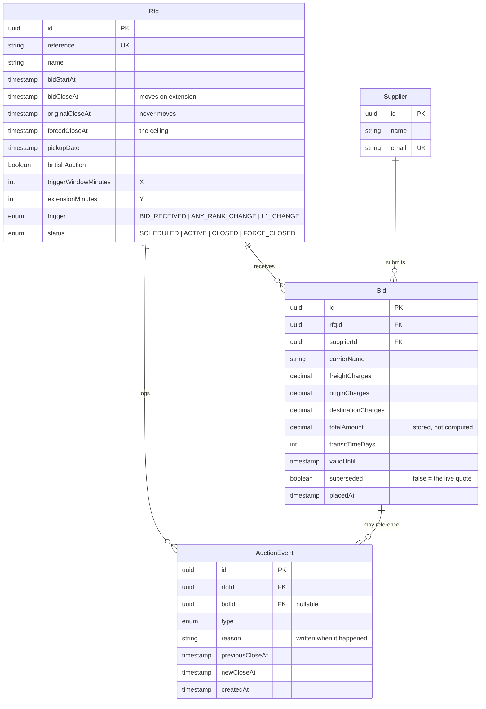

# Schema design

Four tables. The shape is driven by one question the brief asks repeatedly:
*"why did this auction extend?"*

## Decisions worth defending

**Three close times on `Rfq`, not one.**

| column | role |
|---|---|
| `originalCloseAt` | what it was created with, never moves |
| `bidCloseAt` | the live close, moves on every extension |
| `forcedCloseAt` | the ceiling, never moves |

Keeping the original is what lets the UI say "extended 12 minutes so far",
which is the metric the brief's success criteria actually ask about
("improved final prices compared to non-extended auctions"). Recovering it from
the event log later would mean replaying every extension on every page load.

**`superseded` instead of a `latest` lookup.**

A supplier may re-quote as often as they like, but only their newest quote
counts. Two ways to model that: keep every bid and take each supplier's latest,
or flag the old ones.

The flag wins because ranking happens on *every bid submission*, in the hot
path, under a lock. `WHERE rfqId = ? AND superseded = false ORDER BY
totalAmount` is one indexed scan. "Latest per supplier" is a window function or
a correlated subquery that no index covers well, and it gets slower exactly as
an auction gets busy. History is still complete — superseded rows are kept, not
deleted.

**`totalAmount` stored rather than computed.**

It is the sum of three columns, so storing it is denormalisation. It earns its
place because ranking orders by it on every write, and a stored column can
carry the `(rfqId, superseded, totalAmount)` index that makes that ordering
free. A computed expression cannot. It is written in the same statement as its
three parts, inside the same transaction, so it cannot drift.

**`DECIMAL(12,2)`, never float.**

These are freight charges. Binary floating point cannot represent 0.10, and a
reverse auction is decided by the smallest difference between two totals — the
one place rounding error changes who wins.

**`reason` is a stored string, not an enum.**

A code would be smaller and translatable. But the brief asks for "reason for
each extension", and the useful answer is *"supplier ranking changed at
position L2 inside the trigger window; extended by 3 minutes"* — which depends
on the ranking at that instant. Reconstructing that from a code plus
timestamps later is guesswork. It is written by the same function that made the
decision, at the moment it made it.

**`EXTENSION_CAPPED` is its own event type.**

When a trigger fires but the ceiling is already reached, nothing changes — and
recording nothing would lose the only evidence that distinguishes an auction
that was *still being fought over* when time ran out from one where bidding
simply stopped. That distinction is exactly what `FORCE_CLOSED` means, and the
closing sweep reads these events to decide between the two.

## Indexes

| index | why |
|---|---|
| `Bid (rfqId, superseded, totalAmount)` | ranking, on every bid, under a lock |
| `Bid (rfqId, placedAt)` | the activity feed and tie-breaking |
| `AuctionEvent (rfqId, createdAt)` | the log, newest first |
| `Rfq (status, bidCloseAt)` | the closing sweep's only query |
| `Rfq.reference`, `Supplier.email` | unique, and both get looked up by humans |
